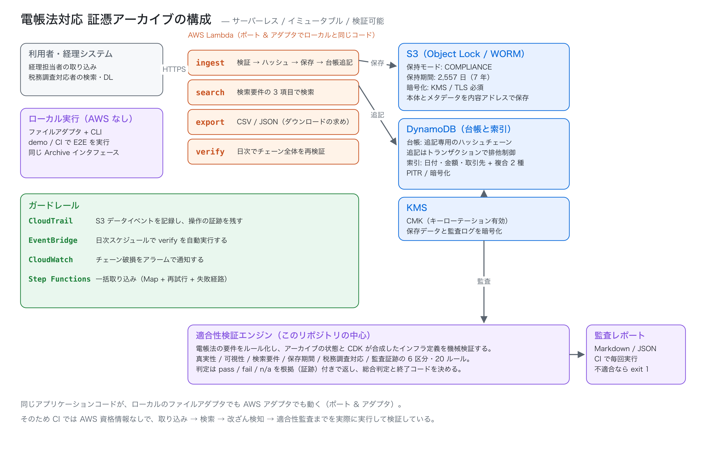
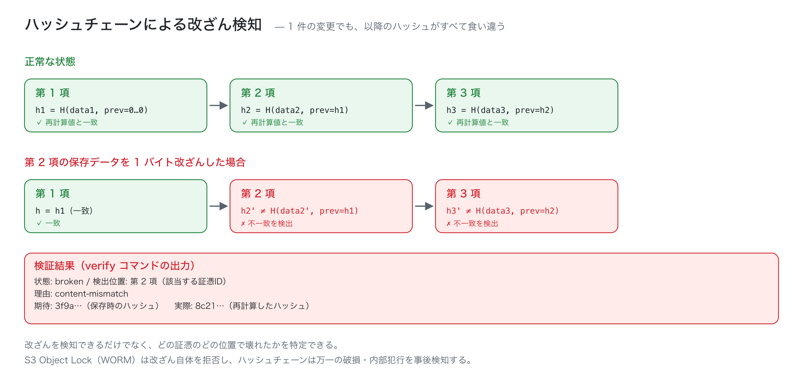

# dencho-archive

[日本語](README.md) · **English**

**A reference implementation of Japan's 電子帳簿保存法 (Electronic Bookkeeping Act) compliant voucher archive — S3 Object Lock, hash-chain tamper evidence, search requirements, and a machine-verifiable compliance audit.**

Since January 2024, storing electronic transaction data electronically is fully mandatory in Japan. Tax-related documents must satisfy three families of requirements — **authenticity (真実性)**, **visibility (可視性)** and **searchability (検索要件)** — for seven years. This project implements them in a form you can *prove* with code and tests.

- **Tampering is detected after the fact** — records are chained by hash, so a single changed byte pinpoints *which voucher, which position, why*
- **Search requirements are proven mechanically** — the three statutory fields (date, amount, counterparty), their combinations, and range queries are backed by an index design and query planner, and the capability is derived from actually running the planner
- **Compliance is auditable** — the law's requirements are encoded as 20 rules evaluated against both the archive's state and the CloudFormation synthesized by CDK, each returning evidence
- **Everything runs without AWS** — the same application code runs on local file adapters and on AWS (S3 + DynamoDB + Lambda). CI executes ingest → search → tamper detection → audit with **no credentials**



---

## In 30 seconds: tamper detection

`dencho demo` ingests vouchers, searches them, exports CSV, verifies the chain — then flips **one byte** of a stored object and verifies again.

```console
$ dencho demo
...
4. Verify the hash chain and run the compliance audit
Status: intact / entries verified: 5
Head hash: 02cab77ec80cd488…
Checkpoints verified: OK
(Pre-tamper audit) Verdict: COMPLIANT (pass 19 / fail 0 / n/a 1)

5. Change one byte of stored data and see whether it is detected
Tampered: one byte of INV-2026-0611-007
Re-verification: ✗ broken
  Detected at: entry 3 (INV-2026-0611-007)
  Reason: content-mismatch
  Expected: e0ae3e90cd6b0158…
  Actual:   7016cca3f6082b97…

6. Compliance audit
Verdict: NON-COMPLIANT (pass 18 / fail 1 / n/a 1)
Failed rule:
  ✗ AUTH-04 The hash chain is intact
```



`S3 Object Lock` (WORM) **refuses** tampering; the hash chain **detects** tampering that happens anyway (corruption, insider action, restored-from-backup tampering). Neither alone is sufficient, so both are implemented.

## Mapping to the Act's requirements

| Requirement | Implementation | Rule(s) |
| --- | --- | --- |
| Authenticity — timestamp | A TSA stamps a digest bound to both content and metadata | `AUTH-01` `AUTH-02` `AUTH-03` |
| Authenticity — WORM / history | S3 Object Lock (COMPLIANCE / 2,557 days) + hash chain | `AUTH-04` `AUTH-05` `INF-01` `INF-02` |
| Visibility | Displayable metadata + indexes | `VIS-01` |
| Searchability (date / amount / counterparty) | 5 DynamoDB-compatible indexes + query planner | `VIS-01` `VIS-02` `VIS-03` |
| Two-field combinations and ranges | Composite indexes + bounded range queries | `VIS-02` `VIS-03` |
| 7-year retention | Checked in configuration *and* in Object Lock retention | `RET-01` `INF-02` |
| Tax-audit "download request" (ダウンロードの求め) | Searchable export to CSV / JSON | `DL-01` |
| Audit trail | CloudTrail data events, PITR, KMS rotation, alarms | `INF-03`–`INF-10` |

Full mapping: [docs/COMPLIANCE_MAPPING.ja.md](docs/COMPLIANCE_MAPPING.ja.md) (Japanese). AWS design: [docs/INFRA.ja.md](docs/INFRA.ja.md). Design notes: [docs/ARCHITECTURE.ja.md](docs/ARCHITECTURE.ja.md).

## Features

| Capability | Detail |
| --- | --- |
| Append-only ledger | Hash-chained; optimistic concurrency prevents two appends at the same position |
| Idempotent ingestion | `voucherId` de-duplicates retries — SQS redelivery or API retries never double-register |
| Content-addressed storage | SHA-256 keys make retries safe and storage self-deduplicating |
| Five indexes | date / amount / counterparty / counterparty+date / counterparty+amount; range queries bounded at ≤16 accesses |
| Counterparty normalization | 「株式会社サンプル商事」and「サンプル商事(株)」match the same company |
| Audit trail | CloudTrail (S3 data events) / PITR / KMS rotation / integrity alarms |
| **Compliance engine** | 20 rules (10 archive + 10 infrastructure) with evidence |
| Deterministic output | Same input ⇒ same reports and CSV, so CI diffs are meaningful |
| Offline end-to-end | Ports & adapters let the whole flow run without cloud credentials |

## Quick start

Node.js 20.11+.

```bash
git clone https://github.com/shiyuanyeming-hub/dencho-archive.git
cd dencho-archive
npm install
npm run build
```

### 1. Ingest the sample vouchers

```bash
dencho init --dir .dencho
dencho ingest --dir .dencho --bulk examples/inbox/manifest.json
```

### 2. Check the search requirements

```bash
dencho capability --dir .dencho
```

```text
Search requirement coverage
│ transaction date      │ ✓
│ amount                │ ✓
│ counterparty          │ ✓
│ date range            │ ✓
│ amount range          │ ✓
│ 2-field combinations  │ transactionDate+amount, transactionDate+counterparty, amount+counterparty
│ export formats        │ csv, json
```

### 3. Search (tolerating spelling variants)

```bash
dencho search --dir .dencho --from 2026-04-01 --to 2026-06-30 --counterparty サンプル商事
```

### 4. Export for a tax audit

```bash
dencho export --dir .dencho --format csv --from 2026-01-01 --out out/download.csv
```

CSV is UTF-8 **with BOM**, CRLF, RFC 4180 quoted — so it opens correctly in Excel (a real requirement in Japanese accounting practice).

### 5. Audit compliance

```bash
dencho audit --dir .dencho --infra auto --format markdown --out reports/audit.md
```

`--infra auto` loads the CDK-synthesized CloudFormation and checks the infrastructure too (Object Lock mode/retention, public access block, CloudTrail data events, PITR, KMS rotation…).

```console
Audit result: COMPLIANT (pass 19 / fail 0 / n/a 1 / error 0)
```

### 6. See everything at once

```bash
dencho demo
```

### Exit codes

| Code | Meaning |
| --- | --- |
| `0` | Success (audit compliant) |
| `1` | Verification failed (broken chain / non-compliant) |
| `2` | Argument or runtime error |

## What the audit checks

All rules return evidence, so a reader can see *why* a verdict was reached.

| Rule | Severity | What it checks |
| --- | --- | --- |
| `AUTH-01` | mandatory | Every voucher carries a timestamp |
| `AUTH-02` | mandatory | Stamped within 62 days of receipt (practical deadline under the Act) |
| `AUTH-03` | mandatory | Timestamp tokens verify |
| `AUTH-04` | mandatory | Hash chain integrity (tamper / deletion / reordering) |
| `AUTH-05` | mandatory | If timestamps are not the chosen method, WORM or revision history secures authenticity |
| `VIS-01` | mandatory | The three statutory fields are indexed |
| `VIS-02` | mandatory | Two-field combination search works |
| `VIS-03` | mandatory | Date and amount range search works |
| `RET-01` | mandatory | Retention is ≥ 7 years (config *and* Object Lock) |
| `DL-01` | mandatory | CSV / JSON download export works |
| `INF-01` | mandatory | S3 Object Lock enabled |
| `INF-02` | mandatory | Retention mode COMPLIANCE and ≥ 7 years |
| `INF-03` | mandatory | Bucket versioning enabled |
| `INF-04` | mandatory | Public access fully blocked |
| `INF-05` | mandatory | Data encrypted with KMS |
| `INF-06` | recommended | TLS enforced |
| `INF-07` | mandatory | CloudTrail records S3 data events |
| `INF-08` | mandatory | DynamoDB point-in-time recovery enabled |
| `INF-09` | recommended | KMS key rotation enabled |
| `INF-10` | recommended | An alarm exists for chain-integrity failures |

Any mandatory `fail` makes the verdict **non-compliant** (exit code 1). Without infrastructure input, `INF-*` are `not-applicable`, so a local archive can still be audited.

## AWS architecture

Four CDK v2 stacks. They **synthesize with no AWS credentials** (no `fromLookup`).

```bash
$ dencho synth --out cdk-templates
Wrote 4 CloudFormation templates: cdk-templates
  dencho-storage.template.json
  dencho-compute.template.json
  dencho-guardrails.template.json
  dencho-workflow.template.json
```

| Stack | Contents |
| --- | --- |
| `dencho-storage` | S3 (Object Lock COMPLIANCE 2,557 days, versioning, block public access, KMS), 3 DynamoDB tables (ledger / index / checkpoints, PITR), KMS CMK |
| `dencho-compute` | 4 Lambdas (ingest / search / export / verify), least-privilege IAM, DLQ, 9 alarms |
| `dencho-guardrails` | CloudTrail (multi-region, S3 data events, log file validation), log-archive bucket with Object Lock, dashboard, integrity alarm |
| `dencho-workflow` | Step Functions (batch import: Map + retry + failure path), EventBridge daily verify |

The synthesized templates are asserted in tests:

- Object Lock is `COMPLIANCE` for `2557` days
- All four public access blocks are enabled
- PITR is on for every DynamoDB table
- No IAM statement uses `Action: "*"` or `Resource: "*"`
- CloudTrail has an S3 data-event selector

Deployment is the only step that needs credentials:

```bash
npx cdk bootstrap
npx cdk deploy --all
```

## Design notes

### 1. Hash-chained ledger for after-the-fact detection

```text
entryHash = SHA-256( canonical({ sequence, previousEntryHash, contentSha256,
                                 metadataSha256, timestampSha256, recordedAt }) )
```

- content changed → `content-mismatch`
- metadata changed → `metadata-mismatch`
- entry deleted or reordered → `chain-link-mismatch`
- timestamp swapped → `timestamp-mismatch`

Verification **stops at the first break** and reports the expected/actual values and the voucher ID.

### 2. Proving the search requirements

Claiming "you can search" is not enough, so the capability is **derived from the code**: `describeSearchCapability()` actually exercises the planner and reports which fields, ranges and combinations are supported; the audit rules consume it.

Amounts are encoded as 16-digit zero-padded strings so that **lexicographic order equals numeric order**. Five indexes keep every query bounded (amount ranges ≤16 accesses, date ranges by monthly partitions).

### 3. Ports & adapters

`src/core` has no AWS SDK dependency; all I/O goes through ports:

```text
Archive (use cases)
  ├─ BlobStore      → LocalBlobStore / S3BlobStore
  ├─ ManifestStore  → LocalManifestStore / DynamoDbManifestStore (transactional append)
  ├─ IndexStore     → LocalIndexStore / DynamoDbIndexStore
  ├─ Clock          → SystemClock / FixedClock (tests & demo)
  └─ TSA            → LocalHmacTimestampAuthority (swap for RFC 3161 in production)
```

That is what makes the offline end-to-end tests and the Lambda code the *same code*.

### 4. Idempotency and atomicity

- Ingestion is idempotent by `voucherId`; identical retries return the existing record
- Ledger appends use a DynamoDB transaction (head condition check + entry + head update) so two writers cannot fork the chain
- If index writes fail, the ledger is still correct — `dencho reindex` rebuilds the index from the ledger

## Tests and CI

| Item | Value |
| --- | --- |
| Tests | **454** (19 files) |
| Type checking | `strict` + `noUncheckedIndexedAccess` + `noPropertyAccessFromIndexSignature` |
| CDK synthesis | 4 stacks / 45 resources, fully offline |
| Demo | ingest → search → export → tamper detection → audit, on every run |

CI verifies: type checking and all tests on Node 20/22; CloudFormation synthesis with no credentials; the full `dencho demo` (tamper detection included); and sample ingestion → capability check → audit report generation.

## Known limitations

Stated plainly:

- **The timestamp authority is local.** Production must use an RFC 3161 TSA. The local implementation reproduces the structure and verification flow; it is not a legally valid proof of time.
- **One ledger per archive.** Millions of entries would require sharding the manifest (currently one partition per archive).
- **Index rebuild is a full scan.** It is an administrative operation; throttling/parallelism are not tuned.
- **AWS adapters are not integration-tested against the real services.** Without credentials in CI, only unit tests with substituted SDK clients are run.
- **Not legal advice.** This is a reference implementation of the requirements; the final compliance judgement belongs to a licensed tax accountant (税理士).

## License

MIT — [LICENSE](LICENSE)
