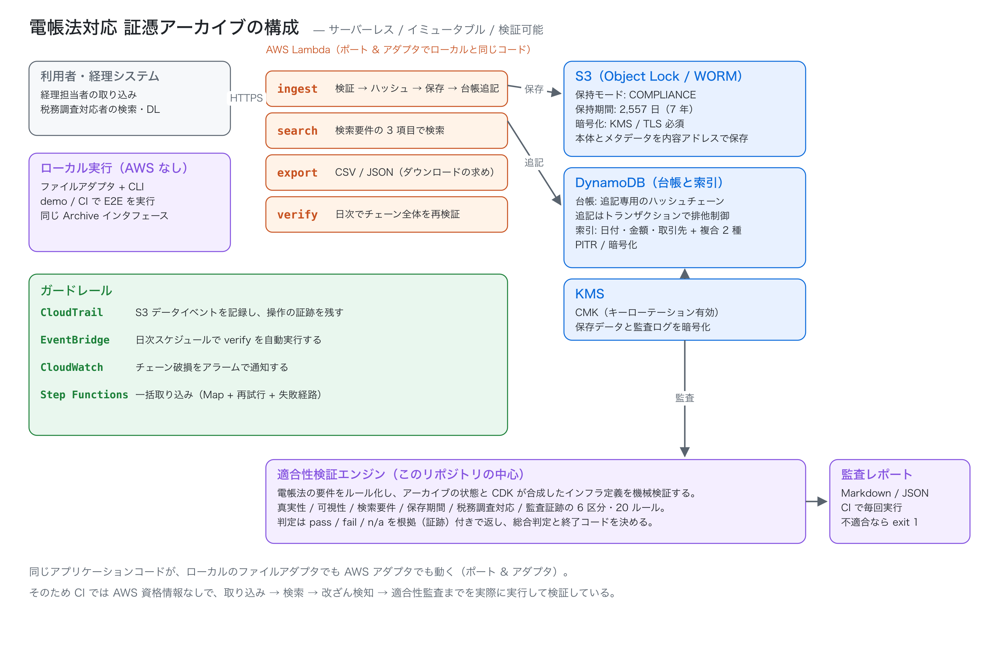
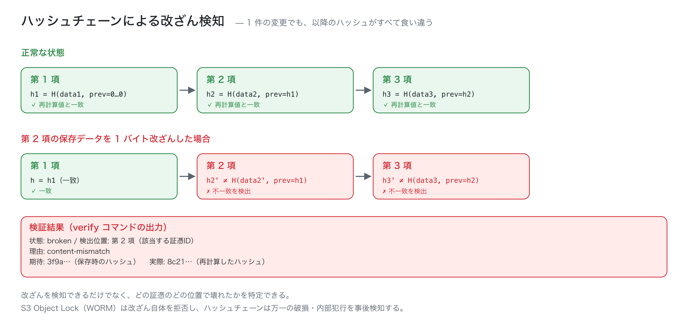

# dencho-archive

[**日本語**](README.md) · [English](README.en.md)

**電子帳簿保存法（電帳法）対応の証憑アーカイブ基盤 — S3 Object Lock・ハッシュチェーン・検索要件・機械検証できる適合性監査。**

2024 年 1 月から電子取引データの保存は完全義務化され、
国税関係書類は「真実性」「可視性」「検索要件」を満たして保存する必要があります。
本プロジェクトは、その要件を **設計とテストで証明できる形** で実装したリファレンスです。

- **改ざんを事後検知できる** — 証憑データをハッシュチェーンで連結し、1 バイトの変更でも
  「どの証憑のどの位置が壊れたか」を特定する
- **検索要件を機械的に証明する** — 取引年月日・金額・取引先の 3 項目と、その組み合わせ・
  範囲指定を、索引設計とプランナで担保する
- **適合性を監査できる** — 電帳法の要件を 20 ルールに落とし、アーカイブの状態と
  CDK が合成した AWS インフラ定義を突き合わせて pass / fail を根拠付きで返す
- **AWS なしで全部動く** — 同じアプリケーションコードが、ローカルのファイルアダプタでも
  AWS（S3 + DynamoDB + Lambda）でも動く。CI は資格情報なしで
  取り込み → 検索 → 改ざん検知 → 監査 までを実際に実行する



---

## 30 秒でわかる: 改ざん検知

`dencho demo` は、証憑を取り込み、検索し、CSV を出力し、チェーンを検証したあと、
保存データを **1 バイトだけ書き換えて** 再検証します。

```console
$ dencho demo
...
4. ハッシュチェーンを検証し、適合性を監査する
状態: intact / 検証したエントリ: 5 件
先頭ハッシュ: 02cab77ec80cd488…
チェックポイント検証: OK

（改ざん前の監査）総合判定: 適合（pass 19 / fail 0 / n/a 1）

5. 保存データを 1 バイトだけ改ざんして、検知できるか確かめる
改ざん: INV-2026-0611-007 の本体 1 バイトを書き換えました
再検証の結果: ✗ broken
  検出位置: 第 3 項（INV-2026-0611-007）
  理由: content-mismatch
  期待: e0ae3e90cd6b0158…
  実際: 7016cca3f6082b97…

6. 電帳法の適合性を監査する
総合判定: 不適合 （pass 18 / fail 1 / n/a 1）
失敗したルール:
  ✗ AUTH-04 ハッシュチェーンが整合している
```



`S3 Object Lock`（WORM）は **改ざん自体を拒否** し、ハッシュチェーンは
**万一の破損・内部犯行・バックアップ改ざんを事後検知** します。
片方だけでは足りないため、両方を実装しています。

## 電帳法の要件との対応

| 要件 | 実装 | 検証するルール |
| --- | --- | --- |
| 真実性の確保（タイムスタンプ） | 保存時に TSA がダイジェストへ時刻証明を付与。本体とメタデータの両方に結びつく | `AUTH-01` `AUTH-02` `AUTH-03` |
| 真実性の確保（WORM / 履歴） | S3 Object Lock（COMPLIANCE / 2,557 日）+ ハッシュチェーン | `AUTH-04` `AUTH-05` `INF-01` `INF-02` |
| 可視性の確保 | 表示可能なメタデータ + 索引 | `VIS-01` |
| 検索要件（①日付 ②金額 ③取引先） | DynamoDB 互換の 5 索引とクエリプランナ | `VIS-01` `VIS-02` `VIS-03` |
| 2 項目以上の組み合わせ / 範囲指定 | 複合索引 + 範囲クエリ（有界なアクセス回数） | `VIS-02` `VIS-03` |
| 保存期間 7 年 | 設定値と S3 保持期間の両方を確認 | `RET-01` `INF-02` |
| 税務調査の「ダウンロードの求め」 | 検索条件を指定して CSV / JSON を出力 | `DL-01` |
| 監査証跡 | CloudTrail データイベント・PITR・KMS ローテーション・アラーム | `INF-03`〜`INF-10` |

要件の詳細な対応表は [docs/COMPLIANCE_MAPPING.ja.md](docs/COMPLIANCE_MAPPING.ja.md)、
AWS 構成は [docs/INFRA.ja.md](docs/INFRA.ja.md)、設計判断は
[docs/ARCHITECTURE.ja.md](docs/ARCHITECTURE.ja.md) にあります。

## できること

| 機能 | 内容 |
| --- | --- |
| 追記専用の台帳 | ハッシュチェーンで連結。楽観的排他制御で「同じ位置への二重追記」を防ぐ |
| 冪等な取り込み | `voucherId` による再送の重複排除。SQS 再配信・API リトライで二重登録しない |
| 内容アドレス保存 | SHA-256 をキーにした保存。同じ内容は同じキーになり、保存の再試行が安全 |
| 5 種類の索引 | 日付 / 金額 / 取引先 / 取引先+日付 / 取引先+金額。範囲指定は最大 16 アクセス |
| 表記ゆれの吸収 | 「株式会社サンプル商事」と「サンプル商事(株)」を同一取引先として検索 |
| 監査証跡 | CloudTrail（S3 データイベント）/ PITR / KMS ローテーション / 破損アラーム |
| **適合性監査エンジン** | 20 ルール（アーカイブ 10 + インフラ 10）を根拠付きで判定 |
| 決定的な出力 | 検索結果・レポート・CSV は同一入力から同一出力（CI の差分レビューに向く） |
| ローカル完結 | AWS 資格情報なしで E2E が動く（ポート & アダプタ） |

## クイックスタート

Node.js 20.11 以上が必要です。

```bash
git clone https://github.com/shiyuanyeming-hub/dencho-archive.git
cd dencho-archive
npm install
npm run build
```

### 1. サンプル証憑を取り込む

```bash
dencho init --dir .dencho
dencho ingest --dir .dencho --bulk examples/inbox/manifest.json
```

### 2. 検索要件を確認する

```bash
dencho capability --dir .dencho
```

```text
検索要件の充足状況
▼
│ 取引年月日            │ ✓
│ 取引金額              │ ✓
│ 取引先                │ ✓
│ 日付の範囲指定        │ ✓
│ 金額の範囲指定        │ ✓
│ 2項目以上の組み合わせ │ transactionDate+amount, transactionDate+counterparty, amount+counterparty
│ 出力形式              │ csv, json
```

### 3. 検索する（表記ゆれを吸収）

```bash
dencho search --dir .dencho --from 2026-04-01 --to 2026-06-30 --counterparty サンプル商事
```

### 4. 税務調査に備えて出力する

```bash
dencho export --dir .dencho --format csv --from 2026-01-01 --out out/download.csv
```

CSV は UTF-8 BOM 付き・CRLF・RFC 4180 準拠です（Excel で文字化けしません）。

### 5. 適合性を監査する

```bash
dencho audit --dir .dencho --infra auto --format markdown --out reports/audit.md
```

`--infra auto` は CDK の合成結果（CloudFormation）を読み込み、
S3 の Object Lock 設定や CloudTrail の有効性まで含めて検証します。

```console
監査結果: 適合（pass 19 / fail 0 / n/a 1 / error 0）
```

### 6. 全部まとめて見る

```bash
dencho demo
```

### 終了コード

| コード | 意味 |
| --- | --- |
| `0` | 成功（監査は適合） |
| `1` | 検証失敗（チェーン破損 / 監査不適合） |
| `2` | 引数・実行時のエラー |

## 適合性監査の中身

20 ルールの内訳です。すべて「根拠（証跡）」を返すため、
レポートを見た人が「なぜ適合／不適合なのか」を追えます。

| ルール | 重要度 | 何を見るか |
| --- | --- | --- |
| `AUTH-01` | 必須 | 全証憑にタイムスタンプが付与されているか |
| `AUTH-02` | 必須 | 付与が受領後 62 日以内か（電帳法の実務上の期限） |
| `AUTH-03` | 必須 | タイムスタンプの検証に失敗していないか |
| `AUTH-04` | 必須 | ハッシュチェーンが整合しているか（改ざん・削除・並べ替え） |
| `AUTH-05` | 必須 | タイムスタンプ方式を採らない場合に WORM 等で真実性を確保しているか |
| `VIS-01` | 必須 | 検索対象 3 項目が索引化されているか |
| `VIS-02` | 必須 | 2 項目以上の組み合わせ検索ができるか |
| `VIS-03` | 必須 | 日付・金額の範囲指定検索ができるか |
| `RET-01` | 必須 | 保存期間が 7 年以上か（設定と Object Lock 保持期間） |
| `DL-01` | 必須 | CSV / JSON のダウンロード出力ができるか |
| `INF-01` | 必須 | S3 Object Lock が有効か |
| `INF-02` | 必須 | 保持モードが COMPLIANCE で 7 年以上か |
| `INF-03` | 必須 | バケットのバージョニングが有効か |
| `INF-04` | 必須 | パブリックアクセスが全面ブロックされているか |
| `INF-05` | 必須 | 保存データが KMS で暗号化されているか |
| `INF-06` | 推奨 | TLS が強制されているか |
| `INF-07` | 必須 | CloudTrail が S3 データイベントを記録しているか |
| `INF-08` | 必須 | DynamoDB のポイントインタイムリカバリが有効か |
| `INF-09` | 推奨 | KMS キーローテーションが有効か |
| `INF-10` | 推奨 | チェーン破損を検知するアラームがあるか |

判定は `pass` / `fail` / `not-applicable` / `error` の 4 値で、
必須ルールに `fail` が 1 つでもあれば総合判定は **不適合**（終了コード 1）です。
インフラ定義を渡さない場合、`INF-*` は `not-applicable` として扱い、
ローカルのアーカイブだけでも監査できます。

## AWS 構成

CDK v2（TypeScript）で 4 スタックを定義しています。**AWS 資格情報なしで合成できます**
（`fromLookup` を使わない設計）。

```bash
$ dencho synth --out cdk-templates
CloudFormation テンプレートを 4 件書き出しました: cdk-templates
  dencho-storage.template.json
  dencho-compute.template.json
  dencho-guardrails.template.json
  dencho-workflow.template.json
```

| スタック | 内容 |
| --- | --- |
| `dencho-storage` | S3（Object Lock COMPLIANCE 2,557 日・バージョニング・BPA・KMS）、DynamoDB 3 本（台帳 / 索引 / チェックポイント、PITR 有効）、KMS CMK |
| `dencho-compute` | Lambda 4 本（ingest / search / export / verify）、最小権限 IAM、DLQ、アラーム 9 本 |
| `dencho-guardrails` | CloudTrail（マルチリージョン・S3 データイベント・ログ検証）、監査ログバケット（Object Lock）、ダッシュボード、破損アラーム |
| `dencho-workflow` | Step Functions（一括取り込みの Map + 再試行 + 失敗経路）、EventBridge（日次 verify） |

合成結果はテストで検証しています。

- Object Lock が `COMPLIANCE` / `2557` 日であること
- パブリックアクセスが 4 項目すべてブロックされていること
- すべての DynamoDB で PITR が有効であること
- IAM に `Action: "*"` / `Resource: "*"` が無いこと
- CloudTrail に S3 データイベントのセレクタがあること

デプロイする場合のみ AWS 資格情報が必要です。

```bash
npx cdk bootstrap
npx cdk deploy --all
```

## 設計の要点

### 1. ハッシュチェーンで「事後検知」する

各エントリは次のように連結されます。

```text
entryHash = SHA-256( canonical({ sequence, previousEntryHash, contentSha256,
                                 metadataSha256, timestampSha256, recordedAt }) )
```

- 本体を書き換える → `contentSha256` が合わない（`content-mismatch`）
- メタデータを書き換える → `metadataSha256` が合わない（`metadata-mismatch`）
- エントリを削除・並べ替える → 連鎖が切れる（`chain-link-mismatch`）
- タイムスタンプを差し替える → `timestamp-mismatch`

検証は **最初に壊れた位置で停止** し、期待値と実際値・証憑 ID を返します。

### 2. 検索要件を索引で証明する

「検索できる」と言うだけでは不十分なので、能力を **コードから導出** しています。
`describeSearchCapability()` はプランナを実際に走らせて、
3 項目・範囲指定・2 項目組み合わせの可否を返し、監査ルールがそれを検査します。

金額は 16 桁ゼロ埋めでエンコードし、**文字列順 = 数値順** にしています。
索引は 5 種類で、どのクエリも有界なアクセス回数で答えられるようにしています
（例: 金額範囲は最大 16 アクセス、日付範囲は月単位パーティション）。

### 3. ポート & アダプタ

コア（`src/core`）は AWS SDK に依存しません。I/O はすべてポート越しです。

```text
Archive（ユースケース）
  ├─ BlobStore      → LocalBlobStore / S3BlobStore
  ├─ ManifestStore  → LocalManifestStore / DynamoDbManifestStore（トランザクションで追記）
  ├─ IndexStore     → LocalIndexStore / DynamoDbIndexStore
  ├─ Clock          → SystemClock / FixedClock（テスト・デモ）
  └─ TSA            → LocalHmacTimestampAuthority（本番は RFC 3161 に差し替え）
```

この構成のおかげで、ローカルで完結する E2E テストと、Lambda で動く本番コードが
**同じコード** になります。

### 4. 冪等性と原子性

- 取り込みは `voucherId` で冪等。同じ内容の再送は既存の証憑を返す
- 台帳への追記は DynamoDB のトランザクションで「先頭の条件チェック + エントリ + 先頭更新」を原子的に実行
- 索引登録に失敗しても台帳は正しい。`dencho reindex` で台帳から索引を再構築できる

## テストと CI

| 内容 | 数 |
| --- | --- |
| テスト | **454 件**（19 ファイル） |
| 型検査 | `strict` + `noUncheckedIndexedAccess` + `noPropertyAccessFromIndexSignature` |
| CDK 合成 | 4 スタック / 45 リソースをオフラインで合成 |
| デモ | 取り込み → 検索 → 出力 → 改ざん検知 → 監査 を毎回実行 |

CI で検証していること:

1. 型検査と全テスト（Node 20 / 22）
2. CloudFormation の合成（資格情報なし）
3. `dencho demo` の完走（改ざん検知が動くこと）
4. サンプル証憑の取り込み → 検索要件確認 → 監査レポート生成

## 既知の制限

正直に書きます。

- **タイムスタンプはローカル実装。** 本番では RFC 3161 準拠の TSA に差し替える必要があります。
  ローカル実装は構造と検証フローを再現するもので、法的な時刻証明ではありません。
- **台帳は単一アーカイブに集約。** 数百万件規模ではマニフェストの分割が必要です
  （現在は 1 アーカイブ = 1 パーティション）。
- **索引ストアの再構築は全件走査。** 管理操作前提のため並列度・スロットリングは未調整です。
- **AWS アダプタは実サービス未接続。** CI では資格情報が無いため、SDK クライアントを
  差し替えた単体テストのみ実施しています（実際の S3 / DynamoDB に対する統合テストは未実施）。
- **法的助言ではありません。** 本プロジェクトは要件を実装したリファレンスであり、
  最終的な適合判断は税理士・顧問税理士にご確認ください。

## ライセンス

MIT — [LICENSE](LICENSE)
